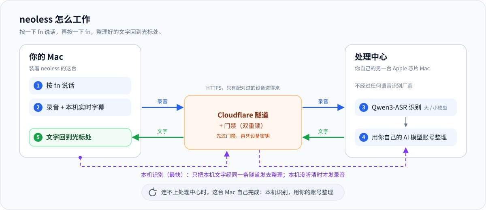
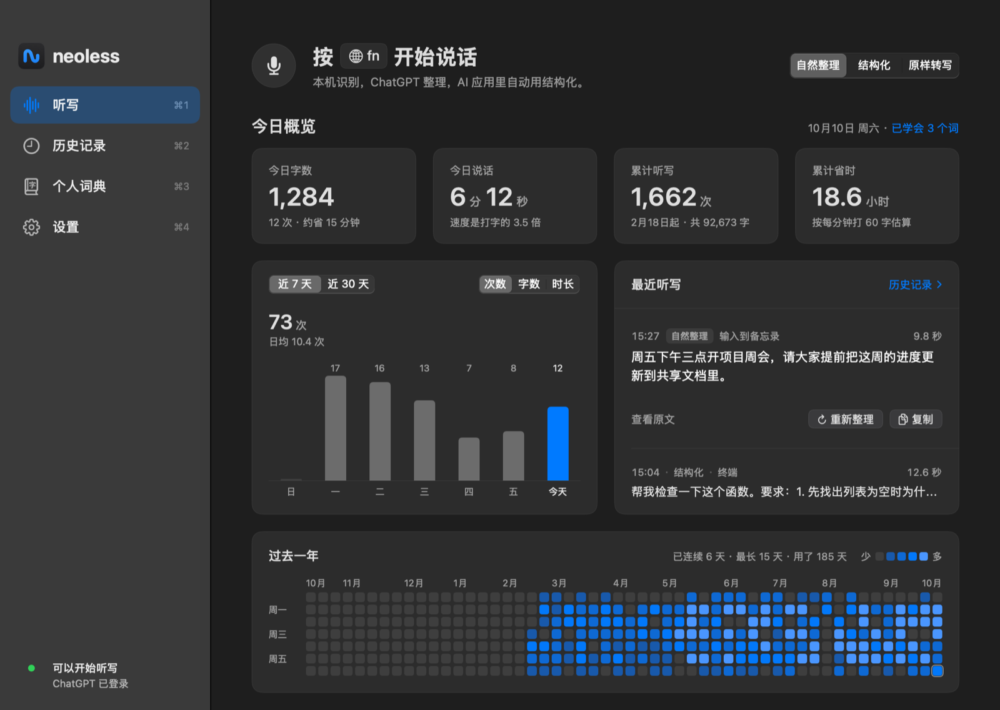
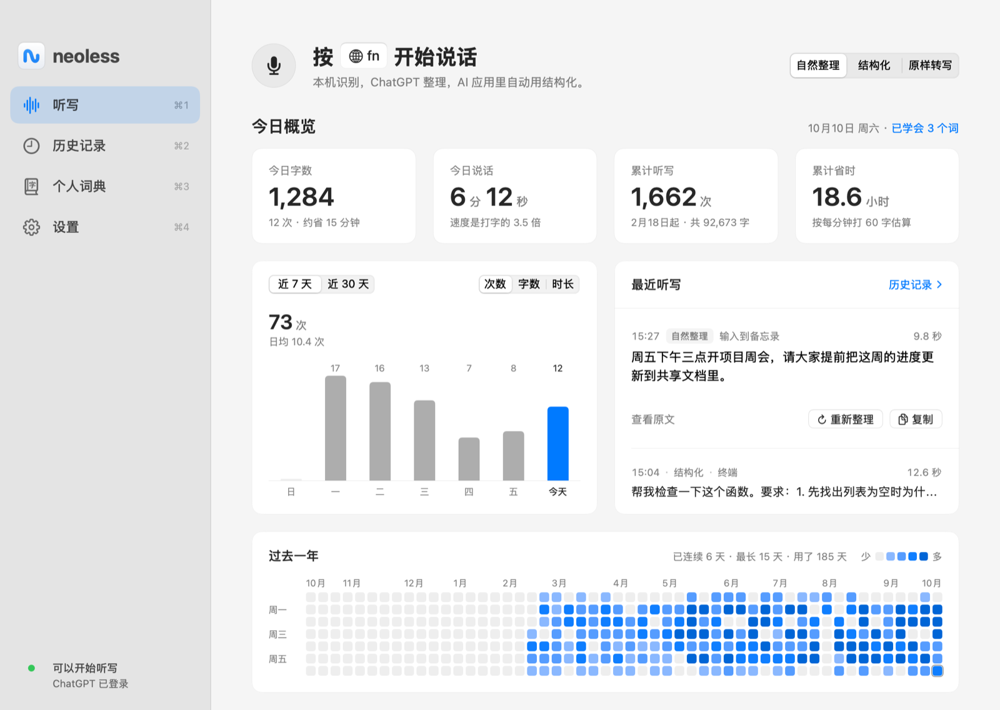
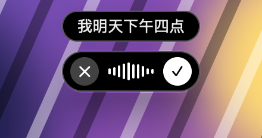
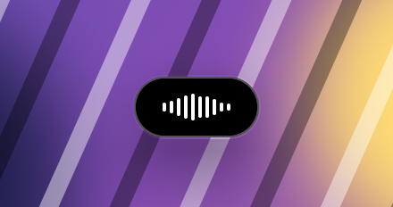
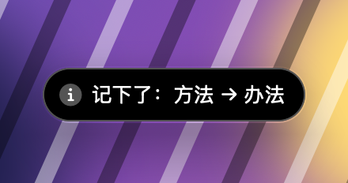
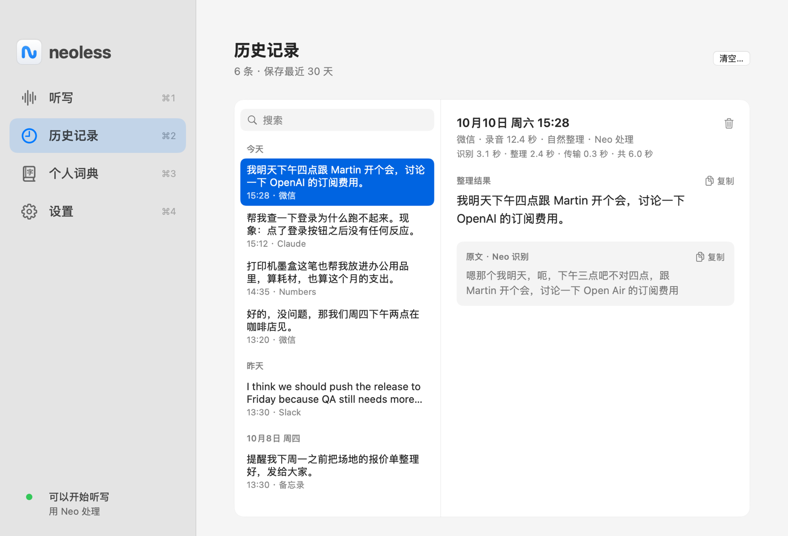
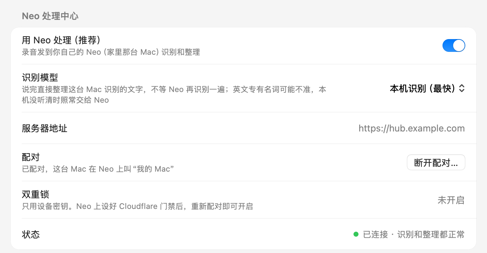
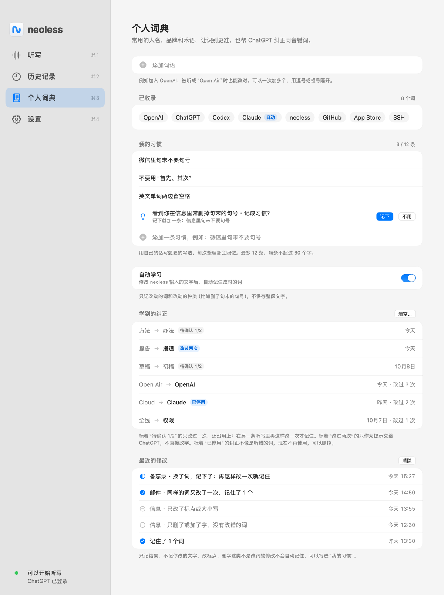
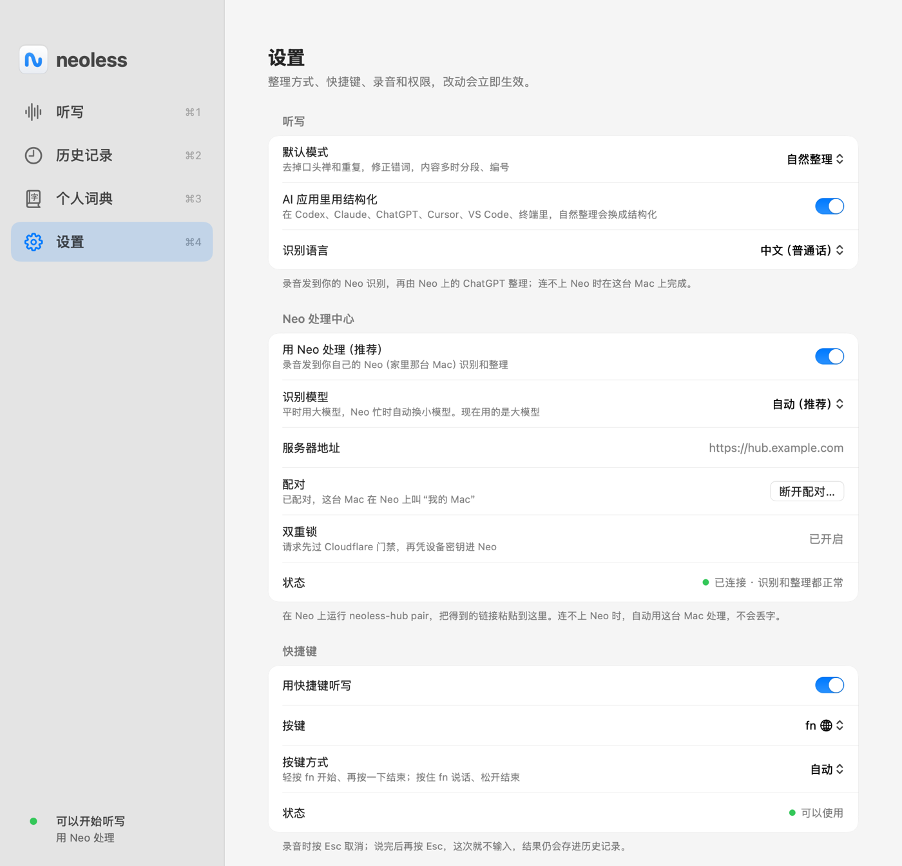

# neoless

按一下 fn 说话，再按一下 fn，整理好的文字就出现在光标处。一个自己用的 Mac 语音输入：录音可以只发到你自己的另一台 Mac 上识别和整理，不经过任何语音识别厂商。

*English summary at the end.*



| 今日概览（深色） | 今日概览（浅色） |
|---|---|
|  |  |

| 录音时的浮层（带实时字幕） | 按住说话 |
|---|---|
|  |  |
| **整理中** | **记下一次改词** |
|  |  |

| 历史记录：每一步用了多久 | 识别模型：本机识别（最快） |
|---|---|
|  |  |

| 个人词典、我的习惯和学到的纠正 | 设置：Neo 处理中心和双重锁 |
|---|---|
|  |  |

截图都是用编的示例数据渲染的（`neoless --snapshot`）：里面的数字、词、句子、时间和服务器地址（`hub.example.com`）都是编的，不是谁的真实听写或设置。

## 它是什么

- 一个菜单栏里的 Mac app（SwiftUI，只用 Command Line Tools 就能编译）。fn 开始和结束，说完的话经过整理（去口头禅、处理改口、修同音错字、内容多时分段分条），输入到你说完时光标所在的输入框。
- 一个可选的“处理中心” **neoless-hub**（界面里叫 **Neo**）：跑在你自己一台 Apple 芯片的 Mac 上，用 MLX 上的 Qwen3-ASR 识别，用你自己的 AI 模型账号整理。设备经 Cloudflare 隧道找到它，前面可以再加一道 Cloudflare Access。
- 不配对处理中心也能用：识别用 Mac 自带的本机语音识别，整理直接用你在这台 Mac 上登录的账号。配对之后连不上（睡眠、断网、超时）时也自动退回这条路，不会丢字。

它不是产品：没有安装包、没有自动更新、没有客服，界面只有中文。写它是因为想要 Typeless 那样的体验，又想让录音留在自己的机器上。思路和取舍写在 [docs/DESIGN.md](docs/DESIGN.md)。

## 它怎么工作

```
fn ─▶ 麦克风（16 kHz）
        ├─▶ Apple 本机语音识别：实时字幕，也是兜底
        │
        ├─ 没配对处理中心 ─▶ ChatGPT 整理（约 1.5–3.5 秒；超时就输入原文）
        │
        ├─ 配对了 ─▶ AAC 录音 ─ HTTPS ─▶ Cloudflare Access ─▶ Cloudflare 隧道 ─▶ 你的 Neo
        │                                    neoless-hub：解码 ─▶ Qwen3-ASR（MLX）─▶ ChatGPT 整理 ─▶ 文字
        │
        └─ 配对了、选了本机识别 ─▶ 只发本机识别出的文字（同一条路）─▶ Neo 上的 ChatGPT 整理 ─▶ 文字
        ▼
   输入到你说完时的输入框（⌘V），之后放回你原来的剪贴板
```

## 要求

- **Mac app**：Apple 芯片；运行要 macOS 14 以上，编译要 macOS 15.2 以上（Swift 6.1 的 Command Line Tools）。不需要 Xcode。
- **整理**：用你自己的 AI 模型账号登录（目前支持 ChatGPT 账号）。
- **处理中心（可选）**：另一台（或同一台）Apple 芯片的 Mac，8 GB 内存够用，要一直开着、接电、不合盖；Python 3.12 以上（`brew install python`，系统自带的 3.9 不行）；cloudflared；一个托管在 Cloudflare 上的域名。

neoless 是个人做的非官方项目，和任何模型提供方都没有关系；用哪家的账号，就受哪家的使用条款约束。

## 安装 Mac app

在要装的 Mac 上打开「终端」：

```bash
git clone <本仓库的地址> ~/neoless      # 在 GitHub 页面点 Code 复制；以后更新直接运行下一行
~/neoless/scripts/install-mac.sh
```

脚本依次：检查机器和 macOS 版本、Command Line Tools 在不在和够不够新（没有就弹出系统的安装窗口）、代码是不是最新；第一次时创建一个只在这台 Mac 上的签名证书（macOS 会弹窗请你确认），这样以后更新不用重新给权限；先构建，构建成功了才动已经装好的版本；装进 `/Applications` 并打开；最后告诉你接下来做什么。出错时用中文说哪一步没完成。可以重复运行。

- `--dry-run`：只说会做什么，什么也不改。
- `--no-install`：只做检查。
- `--import-openless`：如果这台 Mac 上用过 OpenLess，把它的听写历史、词典和纠错规则只读地复制到个人文件夹的 `neoless-openless-samples/<时间>/`（只有你能读，不含登录凭据），供你自己整理成词表导入处理中心。用完删掉。
- 这台 Mac 上有别的也用 Fn 的听写软件时，两个会抢同一个键：换掉其中一个的快捷键。
- 已经装着 neoless 时，更新沿用它原来的 bundle id（`scripts/app-id.sh`），所以权限、设置和配对都还在。

只想自己构建：`scripts/build-app.sh --install`。默认的 ad-hoc 签名每次构建都会变，macOS 会要求重新允许辅助功能和麦克风；先运行一次 `scripts/make-signing-identity.sh` 就不会了。

## 第一次设置

听写页会列出还差哪几步，全部完成后自动隐藏：

1. **麦克风**、**语音识别**：点「允许」。
2. **离线识别模型**：本机识别用的。系统设置 › 键盘 › 听写，打开听写，在“语言”里加上你说的语言，等它下载完。
3. **辅助功能**：系统设置 › 隐私与安全性 › 辅助功能，打开 neoless。快捷键、Esc 和自动输入都需要它。
4. **登录**：在 设置 › ChatGPT 整理 里用你自己的账号登录。没登录时只输入原文。
5. **fn 也会切换输入法**（建议）：系统设置 › 键盘 ›「按下🌐︎键时」设为「不执行任何操作」。

## 使用

**按键方式**（设置 › 快捷键）：

- **自动**（默认）：轻按 fn 开始，说完再轻按一下结束；也可以按住 fn 说话，松开就结束。
- **轻按** / **按住**：只用其中一种。
- fn+←、fn+Delete 这类快捷键照常可用，不会开始听写。按键可以换成右侧 Option 或右侧 Command。有应用开着“安全键盘输入”（比如光标在密码框里）时只能按住说话。

**录音和取消：**

- 录音时屏幕底部居中有一个小黑条（不抢输入框的焦点）：× 取消，✓ 结束；按住说话时只显示声波。上方可以显示实时字幕。
- 录音时按 **Esc** 取消。识别和整理时再按 fn 不会打断；这时按 Esc 只取消“输入”，结果照样整理完、存进历史。
- 轻按开始的录音一分钟没听到说话会自动结束；录满 10 分钟也会自动结束。

**文字会去哪里：**

- 输入到你**说完时**光标所在的输入框，任何应用都行。
- 说完后换了应用或输入框、或者没有能输入的地方：只复制，按 ⌘V 粘贴。听写页会用一句话说明原因。
- 密码框里不输入也不复制。自动结束的录音只输入回开始录音的那个应用。
- 输入后会放回你原来复制的内容；放不回时（格式特殊或太大）会告诉你。
- 结果都在听写页和历史记录里，可以修改、复制、重新整理。
- 历史记录里每条下面有一行小字，写这次等了多久、花在哪，比如“识别 3.1 秒 · 整理 2.4 秒 · 传输 0.3 秒 · 共 6.0 秒”：识别是处理中心识别录音，整理是模型整理，传输是上传和来回路上，共是从松开说话键到文字输入完。用的是这台 Mac 的识别结果时写“本机识别”；等过处理中心、最后没用上它的回答（超时、出错、它没听到）时，最前面写“等 Neo 35.0 秒（没用上）”。这一行是新加的，以前的记录没有。

**今日概览（听写页）：** 今日字数（中文按字算，英文按词算）、次数和大约省下的时间；今日说话的时长，和说话比打字快几倍；累计的次数、字数和省下的时间（按每分钟打 60 字估算，再减去说话用的时间）。下面是近 7 天 / 近 30 天的柱状图（次数、字数、时长），最近几条听写（最新一条点文字就能改），还有过去一年每天一个格子和连续使用的天数。只有真正输入、复制或显示出来的文字才计数；关掉「保存历史」后数字照常统计，不存文字。

**菜单栏：** 左键打开窗口；右键菜单有 开始 / 结束听写、模式、重新输入上一条、复制上一条、设置和退出。⌘W 和 ⌘Q 都只关窗口，neoless 留在菜单栏里；要彻底退出，右键点菜单栏图标选「退出 neoless」。

**切换页面：** 在 neoless 窗口里按 ⌘1 听写、⌘2 历史记录、⌘3 个人词典、⌘4 设置（左边每一行旁边都写着它的键，菜单栏「显示」里也有）。没在输入文字时，直接按 1 2 3 4 也行；光标在输入框里时数字照常输入。

## 三种模式

- **自然整理**（默认）：去掉语气词和重复，处理改口（“三点，不对，四点” → 四点），借助个人词典修正同音错词（Open Air → OpenAI），内容多时自动分段、编号。它只整理你说的话，不会回答话里的问题。
- **结构化**：整理成发给 AI 的请求：要求和限制逐条列出，不回答、不执行，也不添加你没说的要求。默认在 Codex、Claude、ChatGPT、Cursor、VS Code、终端等应用里自动使用。
- **原样转写**：只用识别结果，不经过大模型（你多次改过的纠正仍会套用）。配对了处理中心时，识别仍然在处理中心上做。

想自己改整理用的提示词：见 [docs/hub.md](docs/hub.md) 的“自己改整理指令”。

## 个人词典和学习

词典里的词会交给识别当提示，也告诉模型该怎么写。neoless 还会从你的修改里学；学到的、记下的都在「个人词典」里，看得见，也删得掉，也可以整个关掉。

- **听错的词**：把 neoless 输入的字改对（Open Air → OpenAI），当场记住，显示“已记住：…”。以后整理时作为提示交给模型。
- **换了个词**：改成的词和原来的读音不够像，但有相同的字或读音接近（“方法”改成“办法”），不一定是听错。第一次只记一笔：浮层显示“记下了：方法 → 办法”，接着是“再这样改一次就记住”，这时什么都不会变。在另一条听写里再这样改一次，才算记住，而且记住之后也只是给模型的提示（“原来的词在这句话里明显说不通时才改”），不会直接替换。完全不相干的两个词、换了个人或地方，还有数字、金额、日期、否定、反义、密码这些，改多少次都不记。把字改回去，记的那一笔会撤掉。
- **我的习惯**：标点、语气、格式这类不是改词的偏好，自己写一句就行，比如“聊天软件里句末不要句号”“不要用‘首先、其次’”。写在「个人词典 › 我的习惯」里，一条一行，最多 12 条、每条 60 个字以内，每次整理都照做；配对了处理中心会同步过去。
- **建议一条习惯**：同一种这样的修改（删掉句末的句号、删掉同一个口头语、把编号列表改回一段话）30 天内在 3 条听写里出现，「我的习惯」里会多一行建议。点「记下」才加，点「不用」30 天内不再问。neoless 不会自己加。
- 改了却没学到时，「个人词典 › 最近的修改」写着每次修改的结果：记住了、记下了，还是为什么没记。

## 搭自己的处理中心（Neo）

配对之后，录音发到你自己的 Neo 上识别（Qwen3-ASR，带你的词典作热词）和整理（Neo 上的登录），结果照样输入到光标处；实时字幕仍由这台 Mac 显示。

一共四样东西：语音识别 worker（Python + MLX，只听 127.0.0.1）、Hub（Swift，只听 127.0.0.1）、一条 Cloudflare 隧道（把你的域名的 `/v1/` 接到 Hub）、Cloudflare Access（没有门禁凭据的请求在 Cloudflare 就被拦下，到不了你家）。

1. 准备隧道、写 `local/hub.env`、运行 `scripts/hub-deploy.sh`：步骤在 [docs/hub.md](docs/hub.md) 开头。
2. 给域名加上 Access 门禁（“双重锁”）：同一份文档的“Access 双重锁”，一步一步写了在 Cloudflare 网页上点什么。之后在 Neo 上 `neoless-hub access set`，配对链接就会自带门禁凭据。
3. 在 Neo 上 `neoless-hub login` 登录，`neoless-hub pair --name "我的 Mac"` 生成配对链接。
4. 把链接粘贴到 Mac app 的 设置 › Neo 处理中心。链接里就是密钥：用 AirDrop 或通用剪贴板传，别用备忘录和信息（会同步到 iCloud）。

配对后：

- **识别模型**（设置 › Neo 处理中心）：「自动（推荐）」平时用大模型，Neo 忙时自动换小模型；「大模型」一直用大的，Neo 忙时要多等一会儿；「小模型」一直用小的，更快。大模型和小模型要 Neo 上配了大、小两个识别模型才能选；只配了一个模型、或 Neo 上的 neoless-hub 还是旧版时，只能选自动和下面的本机识别。
- **本机识别（最快）**（同一行的第四项）：不上传录音，说完就把这台 Mac 自己识别出的文字（录音时字幕那一行）交给 Neo 整理，省掉 Neo 再识别一遍的时间；整理、词典、学到的纠正、「我的习惯」、历史和学习都照旧，旧版的 neoless-hub 也能用。代价是识别交给了 Apple 的本机识别：它只按设置里的那一种识别语言听，整句英文常被听成中文的音；英文专有名词也更常错（这是作者用下来的印象，没有量过）。这台 Mac 没听清（没有字、字太少，或本机识别中途断过）时，这一次照常把录音交给 Neo。默认是自动。
- **说话时先热身**：一开始听写，这台 Mac 就请 Neo 把识别模型准备好。Neo 闲置 10 分钟会卸载模型，隔一阵说的第一句本来要先等它重新加载几秒；热身之后，录音传到时模型多半已经在了。最多 30 秒请一次；Neo 是旧版或连不上都不影响听写；选了本机识别时不热身。
- **Neo 忙时不干等**：录音带着这台 Mac 的识别结果时，Neo 最多等自己的识别 2.5 秒 + 录音长度的 0.4 倍（最多 20 秒），过了就改用这台 Mac 的识别结果整理；Neo 不忙时这段时间足够它识别完。刚热身、模型可能还在加载时（隔了十分钟以上的第一句），再多等 3 秒。选了「大模型」时照旧等大模型的结果。
- **中英文混着说**：一段录音里整句整句地换语言时，Neo 先按停顿把录音切开，分别按各自的语言识别，再拼起来。有停顿、换了语言的录音大约要多花一到两倍的时间；换语言时完全没有停顿的切不开，结果仍然看模型。只有一种语言的录音和以前一样只识别一次。
- 个人词典、学到的纠正和「我的习惯」每 5 分钟（以及改动后）和 Neo 同步。历史记录各存各的。
- 连不上 Neo（睡眠、断网、超时）时自动改由这台 Mac 处理，不会丢字；菜单栏图标带感叹号，菜单第一行写着原因。

## 隐私

先说它**会**把什么发出去：

- **整理**（自然整理、结构化）会把**识别出的文字**、你的个人词典、和这段话有关的学到的纠正、你写的「我的习惯」、当前应用的名字发给你登录的模型服务（请求带 `store: false`）。原样转写不发；但配对了处理中心时，录音照样发到处理中心识别，识别出的文字也照样存进它的历史。
- **用处理中心时**（三种模式都一样，包括原样转写），录音（AAC）和本机识别出的文字经 HTTPS 发到你的域名。TLS 在 Cloudflare 的边缘终结，再经隧道到你的 Mac：也就是说 **Cloudflare 在技术上能看到这些流量**。录音不发给任何语音识别厂商。选了「本机识别」（见上）时只发本机识别出的文字，录音不出这台 Mac（这台 Mac 没听清的那一次除外）。
- 没配对（或关掉“用 Neo 处理”）时，录音只在本机识别（`requiresOnDeviceRecognition`），不保存、不上传。

存在哪里：

- Mac app：历史（最近 30 天，文字，不含录音）、词典、学到的纠正、我的习惯、登录，都在 `~/Library/Application Support/neoless/`，文件 0600。和处理中心的配对（设备密钥、门禁凭据）在登录钥匙串里。
- **今日概览的数字**（每天听写几次、多少字、说了多久）只存在本机的 `usage.json`（0600），里面没有任何文字，不上传。
- 处理中心：历史（最多 2000 条文字）、词典、纠正、习惯、设备列表（只存密钥的 SHA-256）、登录、门禁凭据，都在那台 Mac 的 `~/Library/Application Support/neoless-hub/`，目录 0700、文件 0600，不加密。录音只在解码时短暂写进临时文件夹，解完就删；只有你自己给语音识别 worker 设了 `NEOLESS_ASR_KEEP_DIR`（默认不设，用来在自己的声音上比较模型）时，它才会把最近的录音另存一份。日志不写文字和密钥。
- **自动学习**：你在别的应用里修改 neoless 刚输入的文字时，它通过辅助功能读一会儿那个输入框（最多约 2 分钟），只记下“错词 → 正确词”，周围的文字只留长度和哈希。密码框和密码管理器从不读；密码、验证码、金额、网址这类内容不学。“换了个词”的第一次只记两个词和日期。建议习惯只记改动的种类、删掉的那一个词、应用名和时间，没有文字。可以关掉。
- **读不到输入框的应用**：有些应用（Electron 应用、Chromium 浏览器）平时不让辅助功能读输入框里的字。自动学习开着时，neoless 只对内置名单里的应用、只在你对着它听写时请它打开这个功能；Electron 应用看完就关上，Chromium 浏览器打开后 neoless 关不掉（要等浏览器自己收回或重启浏览器）。VS Code 这类编辑器默认不碰，要在 设置 › 输入与学习 里逐个打开。细节在 [docs/hub.md](docs/hub.md)。

## 已知的限制（老实说）

1. **这是非官方的个人项目。** 模型账号的登录随时可能失效；用不用、用哪个账号，请自己判断，并遵守那家服务的使用条款。
2. **识别不是每次都准。** 专有名词、人名、中英夹杂的地方会听错。默认的模型是 Qwen3-ASR 0.6B（4-bit），是个小模型；也可以配 1.7B，它更大、更慢、更占内存。两个模型只在合成语音（`say`）的十几段中英混说录音上比过做法和耗时（[hub/asr/README.md](hub/asr/README.md)），**没有在真人的录音上量过准确率**，也没有和 Apple 的本机识别比过，所以这里不说哪个更准。设置里那一项写的“大模型（更准，慢一些）”是按模型大小说的预期，不是量出来的结果。靠个人词典（热词）、学到的纠正和整理这一步能补回来一部分，补不回来的要自己改。
3. **内置的提示词在公开前重写过。** 提示词的规则是在作者自己的真实听写上比较、调出来的（见 DESIGN.md）；公开时把里面和个人有关的内容、以及沿用别人风格包的句子全部重写了；示例从一开始就是编的（不是真实的听写）；其中和个人话题有关的几条，公开时换成了同样结构的日常话题，其余没变。重写的是句子：章节的先后和规则的分法仍然跟着那份风格包（许可不明，出处见 [CREDITS.md](CREDITS.md)）。重写之后只跑过离线测试，**没有再在真实听写上评测**，效果可能和调好的那一版有出入。
4. **处理中心的安全有几处没做完**（细节在 docs/hub.md 的“契约缺口”）：配对链接里是长期有效、可重复使用的密钥，没有一次性的配对码；Hub 不验证本机 18801 端口上的确实是 worker；Hub 自己的“只收经过门禁的请求”只看请求头在不在，不验签名；没有日志轮转和按 IP 限速。它是按“一个人、自己的几台机器”设计的，在这个前提下可以接受；多人共用一台 Mac 或要给别人用时不够。
5. **处理中心的 Mac 会睡眠。** Hub 只阻止闲置睡眠；合盖、断电、重启后没登录，它就不在线了（设备会退回本机处理）。
6. **只有 Mac app。** iPhone 的 app 和键盘没有做，只是接口按通用设备设计了。
7. **只在作者自己的 Mac 上用过**（Apple 芯片，说的是中文夹英文）。界面只有中文；识别语言只有普通话和英语两个选项。别的输入法、别的语言、Intel Mac 都没试过。
8. **公开的这份代码不是作者每天在用的那一份。** 作者自己在用的 Mac app 和处理中心，是从公开之前的私人版本构建的。为了公开而改的地方只跑过单元测试、`--dry-run` 和截图渲染，**没有装到任何一台 Mac 上真的用过，也没有部署成一个真的处理中心**：默认的 bundle id 和 `scripts/app-id.sh`；去掉了内置的服务器地址，加了 `neoless-hub server`；从数据文件夹读你自己的整理指令（`polish-natural.md` / `polish-structured.md`）；重写的提示词；默认词典；部署脚本给识别进程建 Python 环境、下载模型的 `fetch_model.py`；LaunchAgent 的名字前缀。用新的 bundle id 全新安装这条路也没有试过。第一次用时，请把这几处当成没人跑过的代码。
9. **没有签名公证的安装包**，要自己从源码构建；自签名证书只在你自己的 Mac 上有效。
10. **部署脚本**是从作者自己的部署改成通用的，“新机器从零开始”那条路没有完整跑过（见 docs/hub.md）。
11. **测试**是单元测试（核心逻辑、Hub 的路由、客户端的超时和重试），没有带真实麦克风和真实模型服务的端到端测试。几个和时间有关的测试在很忙的机器上偶尔会失败，重跑即可（或加 `--no-parallel`）。
12. **v1.3 新加的几样**（今日概览、从修改里学的“换了个词”和「我的习惯」、中英混说的分段识别、识别模型的选择）是公开前不久才写完的，作者自己也只用了几天。中英混说的做法只在合成语音上试过。之后加的几样（说话时先热身、Neo 忙时不干等、「本机识别」、历史记录里的用时）也是刚写完的。

## 开发

只用 Command Line Tools：

```bash
swift build                          # 调试构建
swift test                           # 单元测试（核心逻辑、Hub 客户端、Hub）；机器正忙时加 --no-parallel
scripts/build-app.sh --install       # 构建并安装到 /Applications，然后打开
cd hub/asr && python -m unittest test_asr_worker    # 语音识别 worker 的测试（用它的 Python 环境）
```

不需要麦克风或权限的检查（调试构建是 `.build/debug/neoless`）：

```bash
neoless --test-polish "嗯那个我明天三点不对四点跟 Martin 开会"   # 一次真实的整理请求，打印结果和用时
neoless --polish-eval [--mode natural|structured] [--dry-run]   # 固定的一组（编的）逐字稿走一遍真实整理；--dry-run 只打印要发送的内容
neoless --snapshot /tmp/snap                                    # 把每个页面和浮层渲染成 PNG（浅色 + 深色，用示例数据）
NEOLESS_SNAPSHOT_ONLY=home-ready,settings neoless --snapshot /tmp/snap   # 只渲染这几页；overview-* 这样以 * 结尾的是前缀
neoless --check-keys                                            # 不开窗口检查换页的键（⌘1 … ⌘4、直接按 1 … 4）
```

处理中心的命令（`neoless-hub`，全部说明见 docs/hub.md）：`serve`、`server`、`pair`、`devices`、`revoke`、`login`、`status`、`access …`、`import-samples`、`eval`、`transcribe`。

`scripts/make-public.sh` 是作者把自用的仓库导出成这个公开仓库用的：只导出白名单里的路径，导出后再查一遍有没有不该出现的内容。以后的更新是接在这个仓库后面的新提交，所以克隆下来的仓库可以一直 `git pull`。

## 代码结构

| 位置 | 作用 |
|---|---|
| `Sources/NeolessCore/` | 纯逻辑，有单元测试：快捷键状态机（`Hotkey`）、一次听写的流程（`CaptureFlow`）、粘贴和剪贴板规则（`Paste`）、识别分段合并、整理提示词（`PolishPrompt`）、从修改里学（`CorrectionExtractor`、`EditTracker`、`PassageWatch`、`LearningBook`、`LearningLog`）、我的习惯（`Habits`）、今日概览的统计（`UsageStats`）、识别模型的选择（`NeoModel`）、浮层尺寸（`Capsule`）、词典规则 |
| `Sources/NeolessCloud/` | Mac app 和 Hub 共用：登录和整理请求（`ChatGPTAccount`、`Polisher`、`PolishOverrides`）、Hub 的协议和客户端（`HubProtocol`、`HubClient`、`HubDevice`）、录音编码（`AudioUpload`） |
| `Sources/neoless/` | Mac app：录音、Apple 本机识别、粘贴、全局快捷键、浮层（`HUD`）、窗口和今日概览（`MainWindow`、`Dashboard`）、和 Hub 的连接与同步 |
| `Sources/NeolessHubKit/`、`Sources/neoless-hub/` | 处理中心：HTTP 服务（Hummingbird）、路由、存储、配对和登录命令 |
| `hub/asr/` | 语音识别 worker（Python，MLX 上的 Qwen3-ASR；中英混说时按停顿分段识别） |
| `scripts/` | 安装、构建、部署 |
| `docs/` | [DESIGN.md](docs/DESIGN.md)（思路）、[hub.md](docs/hub.md)（处理中心的搭建、接口和命令） |

## 致谢与许可

- 体验上学的是 Typeless（一个商业的语音输入产品）：设备只录音、别处识别和整理，说完的话自动分段分条。
- 录音浮层（底部居中的小黑条、声波、× 和 ✓）的样子在精神上跟的是 Typeless 和 [OpenLess](https://github.com/Open-Less/openless) 的浮层；代码是 neoless 自己的（SwiftUI），仓库里没有它们的源文件或素材。
- OpenLess（AGPL-3.0）：热词块压过“原样保留”的思路、实时字幕条、剪贴板恢复的做法都参考了它。
- 识别：Qwen3-ASR 的 MLX 版（[mlx-community/Qwen3-ASR-0.6B-4bit](https://huggingface.co/mlx-community/Qwen3-ASR-0.6B-4bit)），[MLX](https://github.com/ml-explore/mlx) 和 [mlx-audio](https://github.com/Blaizzy/mlx-audio)。HTTP 服务：[Hummingbird](https://github.com/hummingbird-project/hummingbird)。
- 代码主要由 AI 编程助手（Claude Code）按作者的要求写成，靠测试和日常使用把关。
- neoless 和 Typeless、OpenLess、Cloudflare、Apple 以及任何模型提供方都没有关系。

详细的出处在 [CREDITS.md](CREDITS.md)。许可：**AGPL-3.0-only**，见 [LICENSE](LICENSE) 和 [NOTICE](NOTICE)。

## English summary

neoless is a personal dictation app for the Mac: press fn, speak, press fn again, and tidied text is typed where your cursor was. It is built for Chinese mixed with English, and its interface is in Chinese.

- **Two ways to run it.** On its own, the Mac app uses Apple's on-device speech recognition and your own AI model account (a ChatGPT account today) to tidy the transcript. Paired with **neoless-hub** on another Apple-silicon Mac of yours (the "Neo"), the recording goes there instead: Qwen3-ASR on MLX recognises it and the model tidies it. Or choose 本机识别 (on-device recognition) and only the Mac's own transcript goes to the hub to be tidied, which is quicker but, in the author's use (not measured), more often wrong on English names. The hub is reached through a Cloudflare Tunnel, with Cloudflare Access (a service token) in front of it and a per-device token behind that. If the hub cannot be reached, the app falls back to the local path, so nothing is lost.
- **It learns from your edits.** A misheard word you correct is remembered at once; a word you swap for another twice becomes a hint for the model; writing preferences you put down as "我的习惯" go with every request. Everything learned is visible and can be removed.
- **What leaves your machines.** The recognised text, your word list, your habits and the app's name go to the model service you signed in to. With a hub, audio travels through Cloudflare (which terminates TLS) to your own Mac, in every mode (with 本机识别 only the transcript does, and audio only for a dictation the Mac did not catch): “原样转写” (raw) skips the model, not the hub, and the hub keeps the text in its history. No speech-recognition vendor is involved.
- **Unofficial.** A personal project, not affiliated with any model provider. Signing in with a provider's account is subject to that provider's terms, and the sign-in may stop working.
- **State.** Published without support: build from source, no installer, Apple silicon only, no iPhone app. Recognition accuracy was never measured on real speech. The built-in prompt was reworded for publication: the sentences taken from a style pack and anything personal were rewritten, and the made-up examples that touched personal topics were replaced by everyday ones of the same shape (its outline still follows a third-party style pack of unclear licence, see CREDITS) and has not been re-evaluated on real dictation since. The published tree is not the author's daily build: what was changed for publication passed unit tests and dry runs only. See “已知的限制” above for the rest.
- **Pictures.** The diagram at the top shows the paths: the recording goes through the tunnel and Access to your own Mac and the text comes back; with 本机识别 only the Mac's transcript goes, by the same tunnel; out of reach, the Mac does it all. The screenshots show 今日概览 (light and dark), the capsule while recording, holding fn, tidying and noting a swap, a history entry with where its wait went (recognition, tidying, transfer, total), the 识别模型 row set to 本机识别（最快）, the dictionary with 我的习惯 and learned corrections, and the hub settings with the double lock. All of them are rendered by `neoless --snapshot` from invented example data (the server is `hub.example.com`), not from anyone's dictation or settings.
- **Docs.** [docs/DESIGN.md](docs/DESIGN.md) explains the approach (in Chinese, with an English summary); [docs/hub.md](docs/hub.md) is the hub's setup guide and wire contract.
- **Licence.** AGPL-3.0-only. Credits in [CREDITS.md](CREDITS.md).
