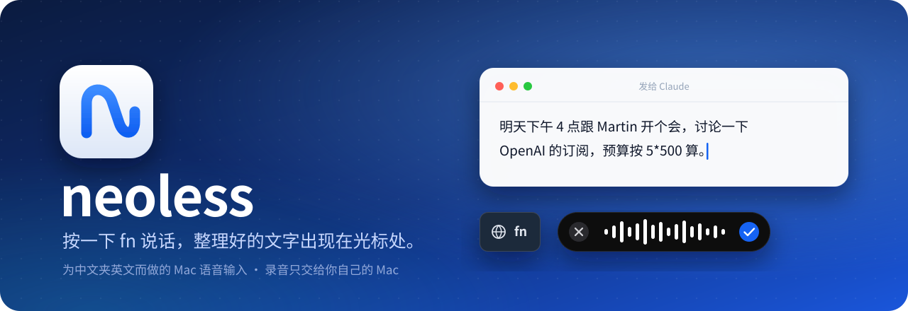
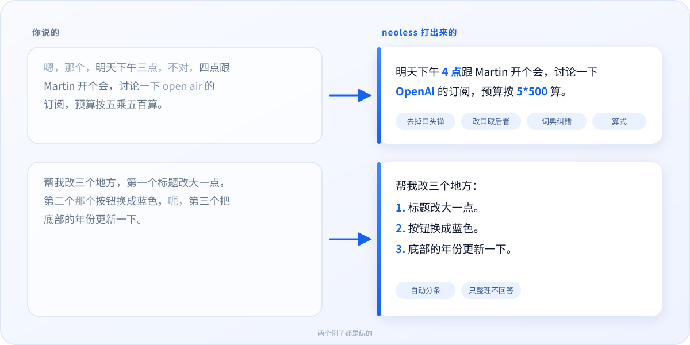
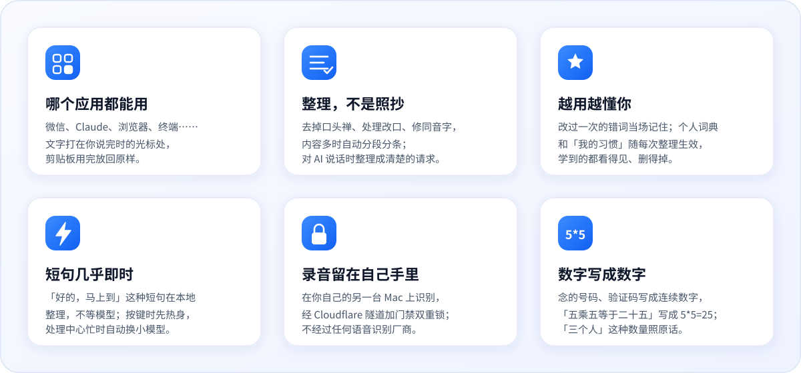

<p align="center">
  
</p>

<p align="center">
  <a href="#快速开始"></a>
  
  
  
  
  
  <a href="LICENSE"></a>
</p>

<p align="center">
  <b>中文</b> · <a href="#english">English</a>
  &nbsp;|&nbsp;
  <a href="#快速开始">快速开始</a> ·
  <a href="#它能做什么">功能</a> ·
  <a href="#截图">截图</a> ·
  <a href="#它怎么工作">原理</a> ·
  <a href="#隐私">隐私</a> ·
  <a href="#常见问题">常见问题</a>
</p>

<br>

neoless 是一个 Mac 菜单栏里的语音输入：**轻按 fn 开始说话，再按一下结束**，说的话经过整理，直接打在你说完时光标所在的地方。它为中文里夹着英文名字和术语的说话方式而做；如果你愿意，录音可以只送到你自己的另一台 Mac 上识别和整理，不经过任何语音识别厂商。

<p align="center">
  
</p>

## 它能做什么

<p align="center">
  
</p>

- **三种模式**：自然整理（默认）、结构化（在 Claude、ChatGPT、Codex、Cursor、终端里自动使用，把口述整理成给 AI 的请求，只整理、不回答）、原样转写。
- **个人词典和学习**：词典里的词同时交给识别和整理；把打错的字改对一次就记住，读音不像、规则拿不准的改动交给 ChatGPT 对照原话判断是不是听错；「我的习惯」用一句话写下偏好，比如“聊天软件里句末不要句号”“把所有的吧换成罢”。
- **今日概览**：今天说了多少字、省了多少时间，近 7 天 / 30 天 / 全部的柱状图，一年的打卡格子。
- **处理中心（可选）**：在另一台 Apple 芯片的 Mac 上跑 Qwen3-ASR（MLX）和整理；连不上时自动退回本机，不会丢字。

## 截图

<p align="center">
  <picture>
    <source media="(prefers-color-scheme: dark)" srcset="screenshots/overview-dark.png">
    
  </picture>
  <br><sub>今日概览，跟着系统切换深色和浅色</sub>
</p>

<table>
  <tr>
    <td width="50%" align="center"><br><sub><b>录音</b>：底部居中的小黑条，带实时字幕</sub></td>
    <td width="50%" align="center"><br><sub><b>按住说话</b>：松开就结束</sub></td>
  </tr>
  <tr>
    <td align="center"><br><sub><b>整理中</b></sub></td>
    <td align="center"><br><sub><b>从修改里学</b>：记下了一次改词</sub></td>
  </tr>
  <tr>
    <td align="center"><br><sub><b>历史记录</b>：每一步用了多久</sub></td>
    <td align="center"><br><sub><b>个人词典</b>：热词、我的习惯、学到的纠正</sub></td>
  </tr>
  <tr>
    <td align="center"><br><sub><b>识别模型</b>：自动 / 大模型 / 小模型 / 本机识别</sub></td>
    <td align="center"><br><sub><b>处理中心</b>：配对和双重锁</sub></td>
  </tr>
</table>

<p align="center"><sub>截图都由 <code>neoless --snapshot</code> 用编的示例数据渲染，服务器地址是 <code>hub.example.com</code>。</sub></p>

## 快速开始

需要 Apple 芯片的 Mac。运行要 macOS 14，编译要 macOS 15.2 以上（Swift 6.1 的 Command Line Tools），不需要 Xcode。

```bash
git clone https://github.com/harrrii/neoless-app.git ~/neoless
~/neoless/scripts/install-mac.sh
```

脚本会检查环境，第一次时创建一个只在这台 Mac 上的签名证书（以后更新不用重新给权限），构建成功后才替换已装的版本，最后用中文告诉你下一步。可以重复运行，以后更新也是这一行；`--dry-run` 只说会做什么。

打开后，听写页会列出还差的几步，全部完成后自动隐藏：

1. 允许 **麦克风** 和 **语音识别**。
2. 下载 **离线识别模型**：系统设置 › 键盘 › 听写，在“语言”里加上你说的语言。
3. 打开 **辅助功能**：系统设置 › 隐私与安全性 › 辅助功能 › neoless。
4. 在 设置 › ChatGPT 整理 里用你自己的账号 **登录**。
5. （建议）系统设置 › 键盘 ›「按下🌐︎键时」设为「不执行任何操作」，免得 fn 同时切换输入法。

## 它怎么工作

<p align="center">
  
</p>

```
fn ─▶ 麦克风（16 kHz）
        ├─▶ Apple 本机语音识别：实时字幕，也是兜底
        ├─ 短句 ─▶ 本地整理（确认过的纠正、替换类习惯、数字和算式、中英文之间的空格）
        ├─ 没配对处理中心 ─▶ ChatGPT 整理（默认 gpt-6-luna，可换；超时就输入原文）
        ├─ 配对了 ─▶ AAC 录音 ─ HTTPS ─▶ Cloudflare Access ─▶ 隧道 ─▶ neoless-hub ─▶ Qwen3-ASR（MLX）─▶ 整理
        └─ 本机识别（最快）─▶ 只发本机识别出的文字（同一条路）─▶ 处理中心整理
        ▼
   输入到你说完时的输入框（⌘V），再放回你原来的剪贴板
```

## 用法

<details>
<summary><b>按键、录音和取消</b></summary>

- **按键方式**（设置 › 快捷键）：自动（默认：轻按开始、再轻按结束，也可以按住说话、松开结束）、只轻按、只按住。可以换成右侧 Option 或右侧 Command；fn+←、fn+Delete 这类快捷键照常可用。
- 录音时屏幕底部居中有一个小黑条，不抢输入框的焦点：× 取消，✓ 结束；上方可以显示实时字幕。
- 录音时按 **Esc** 取消。识别和整理时再按 fn 不会打断；这时按 Esc 只取消输入，结果照样整理完、存进历史。
- 轻按开始的录音一分钟没听到说话会自动结束，录满 10 分钟也会结束。
- 有应用开着“安全键盘输入”（比如光标在密码框里）时只能按住说话。

</details>

<details>
<summary><b>文字会去哪里</b></summary>

- 打在你**说完时**光标所在的输入框，任何应用都行。
- 说完后换了应用或输入框，或者没有能输入的地方：只复制，按 ⌘V 粘贴，听写页用一句话说明原因。等待时切到别的应用也没关系：文字会回到你说话的那个应用，再把你送回去。
- Chrome、Claude 这类应用会告诉 neoless 文字有没有真的进去。AI 还在回答、输入框暂时不让输入时，文字留在剪贴板里，等输入框能输入了再发一次，不会打两遍。
- 密码框里不输入也不复制。输入后放回你原来复制的内容；放不回时（格式特殊或太大）会告诉你。
- 结果都在听写页和历史记录里，可以修改、复制、重新整理。每条下面写着这次等了多久、花在哪（识别 · 整理 · 传输 · 共）。

</details>

<details>
<summary><b>三种模式和整理模型</b></summary>

- **自然整理**（默认）：去掉语气词和重复，处理改口（“三点，不对，四点” → 4 点），借助个人词典修正同音错词（Open Air → OpenAI），内容多时自动分段、编号。它只整理你说的话，不回答话里的问题。
- **结构化**：整理成发给 AI 的请求，要求和限制逐条列出，不回答、不执行，也不添加你没说的要求。默认在 Codex、Claude、ChatGPT、Cursor、VS Code、终端等应用里自动使用。
- **原样转写**：只用识别结果，不经过大模型（你确认过的纠正仍会套用）。
- **整理模型**（设置 › ChatGPT 整理）：默认 GPT-6-Luna（更快），也可以选 GPT-6.1-Sol（更细致）或 GPT-5.6-Luna。用处理中心时它也按这里选的模型整理。
- 想改整理用的提示词：见 [docs/hub.md](docs/hub.md) 的“自己改整理指令”。

</details>

<details>
<summary><b>数字和算式</b></summary>

- 价格、金额、百分比、日期、钟点、版本号写阿拉伯数字（“百分之一点五” → 1.5%，“二十五号” → 25 号）；“三个人”“两次”这种数量照原话。
- 一位一位念的号码、验证码、编号写成连续数字：“一三五七九二” → 135792。
- 念的算式写成算式：“五乘五等于二十五” → 5*5=25，“十二除以四” → 12/4。只写你说的，不替你算结果；识别在停顿处加的逗号不会把一个算式拆开。
- 20 个字以内的短句在本地就写好；短句里带“七十二”“三点”这种要看上下文的数时，交给模型。

</details>

<details>
<summary><b>个人词典、我的习惯和学习</b></summary>

学到的、记下的都在「个人词典」里，看得见，删得掉，也可以整个关掉。

- **听错的词**：把 neoless 打的字改对（Open Air → OpenAI），当场记住，以后整理时作为提示交给模型。
- **换了个词**：改成的词和原来读音不够像（“方法” → “办法”）时，第一次只记一笔；在另一条听写里再这样改一次才记住，而且只是给模型的提示，不会直接替换。不相干的词、人名地名、数字、金额、日期、否定、密码，改多少次都不记。
- **我的习惯**：标点、语气、格式这类偏好，自己写一句，最多 12 条、每条 60 字以内，每次整理都照做，配对了处理中心会同步过去。“把 A 换成 B”这种替换类的习惯在短句里也当场生效。
- **建议一条习惯**：同一种修改（删句末句号、删同一个口头语……）30 天内在 3 条听写里出现，会多一行建议，点「记下」才加。
- 改了却没学到时，「个人词典 › 最近的修改」写着原因。

</details>

<details>
<summary><b>搭自己的处理中心（Neo）</b></summary>

四样东西：语音识别 worker（Python + MLX，只听 127.0.0.1）、Hub（Swift，只听 127.0.0.1）、一条 Cloudflare 隧道、Cloudflare Access（没有门禁凭据的请求在 Cloudflare 就被拦下）。

1. 准备隧道、写 `local/hub.env`、运行 `scripts/hub-deploy.sh`：步骤在 [docs/hub.md](docs/hub.md) 开头。
2. 给域名加上 Access 门禁（双重锁），然后 `neoless-hub access set`，配对链接会自带门禁凭据。
3. `neoless-hub login` 登录，`neoless-hub pair --name "我的 Mac"` 生成配对链接。
4. 把链接粘贴到 设置 › Neo 处理中心。链接里就是密钥，用 AirDrop 传，别用会同步到 iCloud 的备忘录或信息。

配对之后：

- **识别模型**：自动（平时用大模型，忙时换小模型）、大模型、小模型，或 **本机识别（最快）**：不上传录音，只把这台 Mac 识别出的文字交给处理中心整理。
- **说话时先热身**：一按键就请处理中心把模型准备好，隔一阵说的第一句不用等加载。
- **忙时不干等**：处理中心识别超过 2.5 秒 + 录音长度的 0.4 倍（最多 20 秒），就改用这台 Mac 的识别结果。
- **中英文混着说**：整句整句换语言时，按停顿切开、分别识别再拼起来。
- 词典、学到的纠正和「我的习惯」每 5 分钟（以及改动后）同步；连不上时自动改由这台 Mac 处理，菜单栏图标带感叹号。

</details>

<details>
<summary><b>菜单栏和快捷键</b></summary>

- 左键打开窗口；右键菜单有开始 / 结束听写、模式、重新输入上一条、复制上一条、设置和退出。⌘W、⌘Q 只关窗口，neoless 留在菜单栏里。
- ⌘1 听写、⌘2 历史记录、⌘3 个人词典、⌘4 设置；没在输入文字时直接按 1–4 也行。

</details>

## 隐私

| | 发到哪里 | 存在哪里 |
|---|---|---|
| **录音** | 没配对时不离开这台 Mac（`requiresOnDeviceRecognition`）。配对后经 HTTPS 发到**你自己的**处理中心；选了本机识别时不发录音 | 不保存。处理中心只在解码时短暂写临时文件，解完就删 |
| **识别出的文字** | 整理时发给你登录的模型服务（`store: false`），连同词典、相关的纠正、我的习惯和当前应用名。原样转写不发 | 历史记录：Mac 上最近 30 天，处理中心最多 2000 条；文件权限 0600 |
| **配对密钥** | — | Mac 的登录钥匙串；处理中心只存 SHA-256 |

- 用处理中心时，TLS 在 Cloudflare 边缘终结再经隧道到你的 Mac，所以 **Cloudflare 在技术上能看到这些流量**；录音不发给任何语音识别厂商。
- **自动学习** 通过辅助功能读一会儿你刚改过的输入框（最多约 5 分钟，改完马上发送也算），只记“错词 → 正确词”，周围的文字只留长度和哈希；密码框和密码管理器从不读，密码、验证码、金额、网址这类内容不学。规则拿不准的改动只把那几个词发到你自己的处理中心，由它的 ChatGPT 对照当时识别听到的原文判断；数字、否定、人名地名这类不会拿去问。可以关掉。
- 今日概览的数字只存在本机的 `usage.json`，里面没有任何文字。细节见 [docs/hub.md](docs/hub.md)。

## 常见问题

<details>
<summary><b>和系统自带的听写、Typeless、OpenLess 有什么不同？</b></summary>

系统听写只转写不整理。neoless 学的是 Typeless 的体验（设备只录音，别处识别和整理，说完自动分段分条），但识别可以放在你自己的 Mac 上，用你自己的模型账号整理，学到的东西都在你的机器上、看得见。

</details>

<details>
<summary><b>一定要有第二台 Mac 吗？</b></summary>

不用。不配对处理中心时，识别用 Mac 自带的本机识别，整理用你在这台 Mac 上登录的账号。处理中心是给想要更准的中英混说识别、又不想把录音交给厂商的人准备的。

</details>

<details>
<summary><b>会不会把我说的问题当成命令去回答？</b></summary>

不会。转写在提示词里是当作数据传过去的：“帮我查一下明天的天气”整理后还是这句话，不会变成天气预报。

</details>

<details>
<summary><b>有多快？</b></summary>

20 字以内的短句在本地整理，松开按键后通常不到一秒出字。长一些的话取决于识别和模型：在作者的机器上，整理本身通常 1–3 秒。历史记录里每一条都写着时间花在了哪。

</details>

## 现状与路线图

neoless 是作者每天在用的个人项目，按“一个人、自己的几台机器”设计。

- [x] Mac app：三种模式、个人词典、从修改里学、我的习惯、今日概览
- [x] 处理中心：Qwen3-ASR（大 / 小模型自动切换）、Cloudflare 隧道 + Access 双重锁、本机识别
- [x] 提速：短句本地整理、按键热身、忙时改用本机识别结果
- [x] 念的数字和算式直接打成数字
- [ ] iPhone app 和键盘（接口已经按通用设备设计）
- [ ] 一次性的配对码（现在的配对链接是长期有效的密钥）
- [ ] 签名公证的安装包

<details>
<summary><b>使用前请知道</b></summary>

- 这是非官方的个人项目，和任何模型提供方都没有关系；用哪家的账号，就受哪家的使用条款约束，登录也可能随时失效。
- 需要从源码构建；自签名证书只在你自己的 Mac 上有效。界面只有中文，识别语言是普通话和英语，只在 Apple 芯片上用过。
- 识别准确率没有在真人录音上系统评测过；专有名词、人名、中英夹杂的地方仍会听错，个人词典和学到的纠正能补回一部分。
- 公开版的提示词在公开前改写过（出处见 [CREDITS.md](CREDITS.md)），示例都是编的；部署脚本从作者自己的部署改成了通用的，新机器从零开始那条路没有完整跑过。处理中心的几处安全取舍写在 docs/hub.md 的“契约缺口”。
- 几个和时间有关的测试在很忙的机器上偶尔会失败，重跑或加 `--no-parallel` 即可。

</details>

## 开发

```bash
swift build                          # 调试构建
swift test --no-parallel             # 单元测试：核心逻辑、处理中心的客户端和路由
scripts/build-app.sh --install       # 构建并装到 /Applications
cd hub/asr && python -m unittest test_asr_worker    # 语音识别 worker 的测试
```

不需要麦克风或权限的检查（调试构建是 `.build/debug/neoless`）：

```bash
neoless --test-polish "嗯那个我明天三点不对四点跟 Martin 开会"   # 一次真实的整理请求，打印结果和用时
neoless --polish-eval [--mode natural|structured] [--dry-run]   # 一组编的逐字稿走一遍真实整理
neoless --snapshot /tmp/snap                                    # 把每个页面和浮层渲染成 PNG（浅色 + 深色）
```

处理中心的命令（`neoless-hub`）：`serve`、`server`、`pair`、`devices`、`revoke`、`login`、`status`、`access …`、`import-samples`、`eval`、`transcribe`，说明见 [docs/hub.md](docs/hub.md)。思路和取舍见 [docs/DESIGN.md](docs/DESIGN.md)。

<details>
<summary><b>代码结构</b></summary>

| 位置 | 作用 |
|---|---|
| `Sources/NeolessCore/` | 纯逻辑，有单元测试：快捷键状态机、一次听写的流程（`CaptureFlow`）、粘贴和剪贴板规则（`Paste`）、整理提示词（`PolishPrompt`）、短句本地整理（`QuickTidy`、`SpokenNumbers`）、从修改里学（`CorrectionExtractor`、`LearningBook`）、我的习惯（`Habits`）、今日概览（`UsageStats`） |
| `Sources/NeolessCloud/` | Mac app 和处理中心共用：登录和整理请求（`ChatGPTAccount`、`Polisher`）、处理中心的协议和客户端（`HubProtocol`、`HubClient`）、录音编码 |
| `Sources/neoless/` | Mac app：录音、本机识别、粘贴、全局快捷键、浮层（`HUD`）、窗口和今日概览 |
| `Sources/NeolessHubKit/`、`Sources/neoless-hub/` | 处理中心：HTTP 服务（Hummingbird）、路由、存储、配对和登录命令 |
| `hub/asr/` | 语音识别 worker（Python，MLX 上的 Qwen3-ASR；中英混说时按停顿分段识别） |
| `scripts/` | 安装、构建、部署；`make-public.sh` 从作者的自用仓库导出这个公开仓库（只导出白名单里的文件，导出后再检查一遍） |

</details>

## 致谢与许可

- 体验上学的是 Typeless；录音浮层的样子在精神上跟的是 Typeless 和 [OpenLess](https://github.com/Open-Less/openless)，代码是 neoless 自己的。OpenLess（AGPL-3.0）的热词块、实时字幕条、剪贴板恢复的做法都参考了它。
- 识别：[Qwen3-ASR](https://huggingface.co/mlx-community/Qwen3-ASR-0.6B-4bit) 的 MLX 版、[MLX](https://github.com/ml-explore/mlx)、[mlx-audio](https://github.com/Blaizzy/mlx-audio)；HTTP 服务：[Hummingbird](https://github.com/hummingbird-project/hummingbird)。
- 代码主要由 AI 编程助手（Claude Code）按作者的要求写成，靠测试和日常使用把关。
- neoless 和 Typeless、OpenLess、Cloudflare、Apple 以及任何模型提供方都没有关系。详细出处在 [CREDITS.md](CREDITS.md)。

许可：**AGPL-3.0-only**，见 [LICENSE](LICENSE) 和 [NOTICE](NOTICE)。

---

## English

**neoless** is a dictation app for the Mac menu bar: tap fn, speak, tap fn again, and tidied text is typed where your cursor was. It is built for Mandarin mixed with English names and terms; the interface is in Chinese.

- **Tidies, not just transcribes.** Fillers go, self-corrections resolve (“three, no, four o'clock” → 4 点), misheard names are fixed from your word list (Open Air → OpenAI), long passages become paragraphs and numbered items, digits read out become numbers and spoken sums become `5*5=25`. Requests dictated to AI apps are turned into clear prompts, never answered.
- **Learns from you.** A word you correct once is remembered, and a fix the rules cannot judge by sound is checked by ChatGPT against what was actually heard; writing preferences you jot down (“我的习惯”) go with every request; everything learned is visible and removable.
- **Fast.** Short sentences are tidied on the spot without a model call, and recognition warms up as you press the key.
- **Your audio stays yours.** On its own the app uses Apple's on-device recognition and your own AI account. Paired with **neoless-hub** on another Apple-silicon Mac of yours, audio goes there instead (Qwen3-ASR on MLX), through a Cloudflare Tunnel with Cloudflare Access in front. No speech-recognition vendor is involved; if the hub is out of reach, the Mac does it all.
- **Get started:** `git clone https://github.com/harrrii/neoless-app.git ~/neoless && ~/neoless/scripts/install-mac.sh` (Apple silicon, macOS 15.2+ to build, Command Line Tools only).
- **Status.** A personal, unofficial project, not affiliated with any model provider, used daily by its author. Build from source; no notarized installer or iPhone app yet. Screenshots are rendered from invented example data. Docs: [DESIGN.md](docs/DESIGN.md), [hub.md](docs/hub.md). Licence: AGPL-3.0-only.
